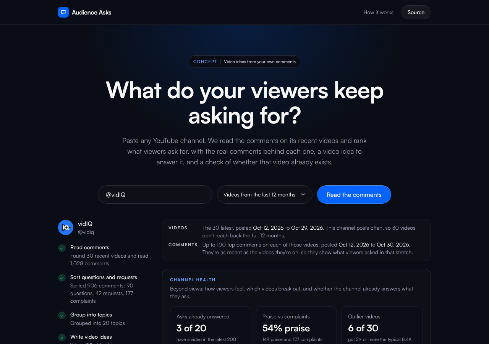

# Audience Asks

**Paste any YouTube channel and see what its viewers keep asking for**, ranked by how many different people asked, with the real comments behind each ask and a video idea to answer it.

**Try it:** [audience-asks.vercel.app](https://audience-asks.vercel.app)




## What it does

1. Finds the channel's latest uploads (up to 50) and reads their top comments through the YouTube Data API.
2. **Sorts** every comment as a question, request, complaint, praise, other or spam (Claude Haiku 5.5, in parallel batches).
3. **Groups** the questions, requests and complaints into topics, each citing the comments it came from (Claude Opus 5.5). Code checks every citation and quote; anything that doesn't check out is retried once, then dropped.
4. **Writes a video idea** per topic: two titles in the channel's style, a hook and why it should work.
5. **Shows channel health beyond views**: how many top asks a past video already answers (and which video to point viewers to), praise vs complaints on each video, and outlier videos with what viewers asked on them.
6. **Checks whether that video already exists**, on request: it searches YouTube for the idea, rates which top results already make it (Claude Haiku 5.5), and says whether the idea is open, has a few takers, is crowded, or is one the channel already made, with links, views and age, and how to stand out.
7. Streams it all to the page as it happens, so cards appear while ideas are still being written.

Filters for questions, requests, complaints, "asked in the last 30 days" and "no video yet"; export to Markdown or copy one idea. It works on any public channel with no sign-in.

## Run it

```bash
npm install
cp .env.example .env.local   # add ANTHROPIC_API_KEY and YOUTUBE_API_KEY
npm run dev                  # http://localhost:3000
```

From the terminal:

```bash
npm run asks -- @vidIQ --videos 20 --months 6
```

By default it reads up to 30 videos from the last 12 months. `--months 0` (or "Any time" in the app) reads the latest videos whatever their age.

As an MCP tool in Claude Code or Claude Desktop, so you can ask "what do my viewers want next?":

```bash
claude mcp add audience-asks -e ANTHROPIC_API_KEY=... -e YOUTUBE_API_KEY=... -- npx tsx "$(pwd)/mcp/server.ts"
```

It has two tools: `audience_asks` for the ranked asks and ideas, and `check_youtube_for_idea` to see whether a video already exists.

Getting keys: a YouTube Data API v3 key is free from the Google Cloud console (enable "YouTube Data API v3", create an API key). An Anthropic key with a few dollars of credit covers hundreds of channels.

## Checks

```bash
npm run typecheck
npm test          # unit tests: grounding, parsing, ranking, SSE
npm run evals     # live evals on frozen snapshots of 5 channels (needs a key)
```

CI runs the type check, tests and build on every pull request, then the evals when the `ANTHROPIC_API_KEY` secret is set. A cited comment that doesn't exist fails the build.

## Docs

- [ARCHITECTURE.md](docs/ARCHITECTURE.md): request path, events, quota maths, caching
- [DECISIONS.md](docs/DECISIONS.md): why no `search.list`, why three AI steps, why topics must cite comments
- [EVALS.md](docs/EVALS.md): method and results
- [AI-WORKFLOW.md](docs/AI-WORKFLOW.md): how it was built with Claude Code, and where the AI was corrected

## Stack

Next.js 16 (App Router, Node runtime), TypeScript, Tailwind CSS 4, the Anthropic TypeScript SDK with structured outputs and zod, the MCP TypeScript SDK, Vitest. It deploys to Vercel's free tier.

---

An independent concept by Tyler. Not affiliated with vidIQ or YouTube.
